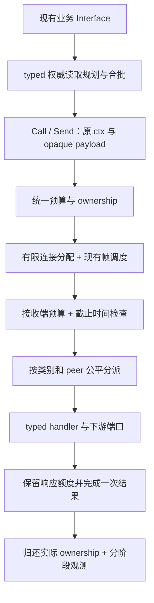

# RPC 容量、流控与调度系统方案

状态：设计提案，未实施。2026-10-23，源基线 `3768ad3e`；容量诊断候选 `103292a9` 不作为最终方案合并。所有本地资源已清理。本文不构成 v3 正式发布通过。

## 1. 判断：排队是最强共同机制假设，最终根因尚未闭合

目前应检验的链路是：

```text
小请求产生多轮 RPC / 下游读取或持久化变慢
  → 某层持有在途额度并等待下游
  → 排队耗尽调用预算
  → 拒绝、重试和更大的在途集合
  → 其它读取、目录投影和 Online Delivery 同时受到影响
```

这比“某个 worker 数太小”更接近需要解决的问题，但不能据此断言底层 TCP 吞吐不足，或把所有错误归到 RPC。

| 证据 | 支持什么 | 不能证明什么 |
| --- | --- | --- |
| 5f 本地约 1,999.15 SEND/s，首次失败为 0，仍有 3 个抽样超期 | 权限入口失败与后续 Online Delivery 故障可独立出现 | 首次发送成功不证明已投递 |
| 旧 8100 带 profile 轮次的一个预先固定超期 person 样本，在三个数据库副本具有唯一一致的消息身份；日志精确匹配 presence 阶段 timeout | 此样本已持久化，失败发生在提交后的路由查询 | 不能外推该轮其它两个样本或 5f 轮次，也不能仅凭 phase 区分配额、网络、CPU、锁或磁盘 |
| 同一旧 8100 带 profile 轮次的六份抓栈分别有 109/45/59/164/15/25 个 recovery quota 等待，每份有 16 个 owner RPC 等待 | 存在明显恢复准入等待，16 个在途恢复正在等待响应 | 没有 owner handler/Registry 锁住的现场；不能将此轮与 5f 指标拼成同请求因果 |
| 5f 区间均值：presence authority RPC client 293.72ms、服务排队 129.53ms、handler 113.18ms；owner handler 0.171ms | 优先调查 authority 排队、恢复占用和请求摊销 | 不同采样不能相减或相加；区间包含停止排空，不是纯运行期同请求分解 |
| 真实三节点隔离：32 个独立双 UID 调用需 64 RPC、2.880ms；相同 64 UID 预打包需 2 RPC、1.035ms | 独立小调用存在请求放大；空载真实网络可很快完成 | 未复现原负载下 5 秒超时，不证明 owner 内部慢 |
| 仅将两层恢复并发 16→64，保留全部内存和原门禁后，约 2,000.72 SEND/s，+35.037s 出现 20 次首次失败/70,017 次发送 | 单独提高恢复并发不足以使原测试通过 | 不能认定等待已消失，或认定全部新失败都是 RPC 队列导致 |

64 候选的首失败相邻窗口有 28 条 permission admission busy 与 2 条 submitter deadline 日志，包含重试且缺少首尝试序号，不能逐条对应上述 20 次。最终 3,633 次失败大部分属于停止阶段的 `session_closed`；最终 55 个未完成样本也不能算通过。

ACK 发布被 Top 锁阻塞、actor-ready 初始分配容量被误报为固定上限，都有独立证据。不能把这些问题改写成同一个 RPC 根因。

上表的 8100 来源为 `full-original-distribution-coalescing-rate2000-three-profile-v1`，5f 来源为 `full-original-distribution-ack-gauge-rate2000-unprofiled-v1`；两个轮次、独立抓栈切面及区间指标都不具备逐请求配对关系。

## 2. 设计目标与保留能力

目标是在固定资源上处理真实业务放大后的 RPC，维持有界内存、可解释的延迟、公平进展和明确的过载结果。RPC/s 必须从运行期按 method 实测，不能用 SEND/s 代替，也不承诺未经测试的“十万 RPC/s”。

现有 transport 已有四类字节感知加权调度、ready frame 批量发送、连接和 service 队列上限、请求预算/取消协商、retained request 记账及有界 observer drain。这些能力继续使用。

需要补齐的系统责任是：

1. 全节点、peer、流量类别和 method 的预算如何组合，谁拥有、何时归还。
2. 多个 service 的 handler 如何公平取得执行机会，以及等待下游时占用了什么资源。
3. 关键流量、普通 RPC、复制/大块数据和维护任务如何共享有限连接和执行资源。
4. caller 的剩余预算如何贯穿每一跳，哪些操作允许合作取消。
5. 业务读取如何减少重复 RPC，同时保留每个调用者的证明与结果契约。

单节点集群与多节点集群遵循相同业务语义。256 Hash Slots、Raft 顺序、fresh Slot barrier、authority/owner boot fences、维护/恢复围栏及写入提交语义不变。

## 3. 推荐：统一生命周期，分层治理

三个候选的比较：

| 候选 | 切入点 | 长处 | 局限 |
| --- | --- | --- | --- |
| A：现有 RPC Module 做深 | Call/Send/Handle 内部 | 调用面小，统一资源与失败所有权，修复集中 | 单靠运输调度不能消除业务重复查询 |
| B：权威读取 Module 合批和流水线 | permission facts / presence proofs | 直接减少业务请求放大，调用者仍用一次批读 | 独立取消、证明生命周期、4096 结果上限使协议实现更复杂 |
| C：method policy 与可扩展 QoS | 注册策略、连接与调度 | 显式表达混合负载、顺序和取消语义 | 配置面必须受控，不能让每个调用者自行选择高优先级 |

推荐以 A 统一 RPC 生命周期，用 C 的有限静态策略治理调度，再逐步实施 B 的领域合批。不是新建一个同时管理消息、presence、存储和 RPC 的总对象。



### 3.1 Interface 保持小，策略在注册时决定

数据面保留现有 Call/Send/Handle；下面是语义示意，不是已经新增的 Go 声明：

```go
Call(ctx, peer, method, payload) // 一次调用；没有隐式业务重试
Send(ctx, peer, method, payload) // 入队成功不代表远端执行或持久化
Handle(method, handler, policy) // 注册可信的分类、顺序、取消与资源契约
```

Owned/Shard 变体及 Start/Stop 仍属于既有 Interface。业务调用者不组合全局票、peer 票和 service 票，也不自行声明“这是只读、给我最高优先级”。

静态 method catalog 统一声明 class、执行/取消语义、顺序、请求/响应边界及队列/执行期限。每次调用只能用原 context 或更小的 reply limit 收紧预算；未知、重复或不兼容策略在启动前拒绝。初期不开放任意优先级、动态权重或运行时池重分配。混合负载采用少量可信策略，不为每个 method 建一个连接池。

`pkg/transport` 处理 opaque payload、生命周期与通用调度；`pkg/cluster/net` 映射稳定 method 策略；access Adapter 解码并验证具体 operation；业务规则与证明仍归原 usecase/runtime。`internal/app` 负责组装和生命周期。

### 3.2 一份 ownership，多个独立资源维度

统一准入联合检查 global / peer / class / service 的 item、request bytes、response bytes 和 accepted work 上限，不串联多个持票阻塞信号量。必须保证嵌套 RPC 不形成父请求持有全部票、子请求无法开始的环。

请求、响应、排队与执行状态分别计账；一个 payload 在 Module 内转移时不重复扣全局额度。复制和分配前证明预算可用，实际完成、拒绝、取消、断连和 Stop 只有一个 terminal owner 归还额度。

响应、取消和必要控制消息要有保留进展容量，防止请求把所有内存占满后连响应都无法发送。已开始 mutation 的响应/结果责任必须在执行前取得相应保证，不能写完之后因响应额度不足伪装成“未提交”。

各类别具有保证份额、可借用余量与硬上限；borrow 不侵占其它类别的最低进展保证。最初使用少量经测量冻结的策略，不先上自动调参控制器。queued bytes、RPC response heap、owned UID bytes 和进程 RSS 是不同指标。

本地 ownership 状态必须显式闭合：

| 状态 | 仍持有的资源 | 可以释放什么 |
| --- | --- | --- |
| 已接受、等待执行 | accepted work、request backing、结果责任 | 开始前取消可移除队列并终结；正在写出的 frame 不能提前复用 backing |
| 执行中 | accepted work、request/response reservation、execution slot | 只能在真实 yield 或 handler 结束时归还 execution slot |
| 等待下游 | accepted work、必要输入与 response reservation、下游请求自己的 ownership | deferred 路径归还 execution slot；caller 超时不伪造对端完成 |
| 响应排队/写出 | 响应 backing 和发送责任；必要的提交结果记录 | 不再需要的请求输入可以归还；响应 backing 等 writer 真实完成或断连终结后归还 |
| 终结 | 不保留该请求的 transport owner | 单一 terminal owner 恰好一次释放；业务幂等/提交记录仍按原契约保留 |

预算按进程和方向独立核算，不把同一条跨节点请求当作一个跨机器共享 lease。准入不足时只允许在有界、可取消的等待集合排队，或给出明确拒绝；不能持部分预算继续等另一维。嵌套调用也不能占着全部执行位置阻塞等待子调用：需要真实 yield，并为下游和 response/cancel 留出不可被普通请求借走的进展额度。无法取得有界下游预算时应明确失败并释放本地责任，不能形成互相等票的闭环；正常目标负载出现这种拒绝仍算门禁失败。

“统一”指同一套所有权规则，不要求每个请求争抢一个全局互斥锁。热路径使用分区账本与有界批量额度租借，但全局硬上限、份额回收和公平性必须可核对；第一版若采用更简单的共享账本，也必须以锁争用、alloc/op 和 CPU/完成请求证据决定是否需要分区，不能凭空引入无锁框架。

### 3.3 公平分派与有界下游等待

复用 service queue 和现有 executor，统一选择可执行的 service/peer 队首，保留必要 FIFO、age 和协议顺序。Raft 不因这个改造而并行重排。

执行中 handler、等待下游的 accepted work、网络在途请求是不同状态。若采用 deferred completion，handler 必须真正释放执行位置，同时保留 accepted/payload/response credits，且只完成一次。另起 goroutine 后让原 handler 同步等待，不算解决 worker 占用。

先治理当前可测的执行和内存资源；CPU 成本通过 profiling/每完成请求成本验证，不把 handler 墙钟时间冒充 CPU 配额。

### 3.4 有限连接分配与流量隔离

现有默认每 peer 16 个连接，部分 method 固定 service key，部分 Channel 调用使用 Channel shard key。取模分配不是隔离保证：例如 owner RPC 的默认连接槽与 Channel pull 相同。加权帧调度不能抢占已经开始的 socket write。

在总连接上界内显式分配关键协议、前台 RPC、bulk/maintenance 的连接归属及响应进展预算；所有 Call/Send/Shard 入口走同一选择规则。无顺序要求的热点读取可在其类别允许的连接内分散，不能用随机条带化破坏 Raft 或已有 Channel 顺序。

连接策略按启动版本固定；迁移要测试在途排空、旧 peer、断连和重连。首阶段不修改 wire frame 大小或引入大块分片协议，只有证明当前写入不可抢占确实影响关键流量后再独立设计。

首选 protocol、foreground、background 三类物理连接归属，逻辑 class 再区分前台读/写、bulk 与维护；它们共同使用原总连接预算，不能变成每类各复制一套 16 连接。具体份额由混合负载测量后冻结。

### 3.5 一次截止时间与可信的操作语义

准入、排队、发送、远端执行及子调用都消耗原剩余预算，不在每层重新获得一个完整 5 秒。预算用剩余时长传播，本地阶段用本地单调时钟测量，不要求跨机器比较单调时间原点。

现有 presence authority/owner 服务是混合操作。调用端超时不能证明其已开始的远端工作同时结束。只读路由查询应通过可信注册分类或独立版本化只读 method 合作取消；不能把整个 mixed service 改成可取消而中断 mutation。

排队未开始取消与已开始 mutation 必须区分。超时、断连或响应丢失不证明未提交；原 idempotency/committed-outcome recovery 仍负责这种不确定结果。只有明确 unsupported 才选择旧协议 Adapter，timeout/busy 不作为降级或自动重发依据。

Stop 关闭 admission、取消未开始工作并通知可取消读取，然后等待真实 owner 归还。期限耗尽必须返回明确的 `StopIncomplete` 与剩余固定计数，不能将超时返回称为已经 quiescent；Go 不能强杀不合作的 handler。composition 在依赖仍被 owner 使用时不得先关闭它，最终进程退出和未完成清理要有明确责任。

### 3.6 领域合批与证明生命周期

保留两个深 Module 的常见 Interface：`ReadSendPermissionMetadataBatch` 与 `EndpointsByTargets`。transport 不解析 UID、ban 或 target。

Permission 在 fresh barrier 前封口，迟到 caller 进入新一轮；不能把完成的权限结果变成 TTL 缓存。Presence 可以共享同 UID/分布式身份的 flight，但成功后 caller 必须重读当前 Directory；未知、部分 owner evidence 不证明 offline。

独立小 caller 的 packing 需要独立预算、取消和结果责任。两个各自合法的 4096-route 调用，不能合并后因共享总 4096 而失败。任意跨 caller 合批上线前必须实现版本化、按原 call 隔离的有界 subround/continuation：每执行页仍至多 4096，每原 call 累计仍至多 4096，完整证明和最终 fence 检查后才发布。旧 peer 保持原调用路径。

这一协议未验证前，仅使用已有安全合批/同 UID 去重。发送入口按读取 credits 反压，不把已经接受的工作不断移入更深的队列；已 durable append 的消息保持原 Online Delivery 责任与失败语义。

## 4. 先补完整归因，再选择实施参数

每个 RPC 生命周期需要可关联地观测：outbound admission、outbound queue/write、inbound queue、handler execution、awaiting downstream、response write、caller completion。区分 queued、executing、waiting、expired-before-start、canceled-after-start、busy 和 ambiguous。

聚合标签仅用固定 method/class/stage/outcome，不新增用户、Channel、Slot、节点身份或 request ID 等高基数标签。peer 明细通过既有有界 Operations 查询给出。少量、到期、可控的 trace 样本沿现有诊断面保存，observer 不进入 ACK/业务临界区阻塞。

使用同请求分段时钟验证排队在哪一层形成；独立 histogram 的均值不能拼成单条请求。运行期和停止排空期必须分开。测量到达率、完成率、队列年龄、请求/响应大小及 RPC/SEND 放大系数，先据此冻结预算与公平目标，再实现；不能以一个新默认数字替代容量依据。

容量预算单独形成验收输入：从活跃期测得各 method 的到达率、批大小、响应大小与服务时间分布，列出平均在途需求 `L = λW`，但不把平均值当 P99 保证。队列等待目标必须从原端到端预算倒推，超过剩余预算的工作不再进入执行。用相同二进制测独立的吞吐—延迟曲线、单热点 peer、大响应和混合流量拐点，记录 RPC/成功 SEND、CPU/完成请求、alloc/完成请求、retained bytes、队列年龄和各 class 的进展。新资源数值与允许的相对退化边界必须在比较前冻结，不根据结果放宽原门禁。

## 5. 实施与验收顺序

| 阶段 | 交付 | 进入下一阶段的条件 |
| --- | --- | --- |
| 0：因果闭合 | 同请求分段归因、active 期 RPC/SEND 计数、可重复混合负载 fixture | 明确瓶颈在准入、运输、执行还是下游；缺信号时不宣称 RPC 引擎根因 |
| 1：统一 ownership | 请求/响应预算及取消/Stop 终结责任 | real TCP 与 controlled Adapter 的 full/cancel/disconnect/nested-call 矩阵通过，owner 和字节归零 |
| 2：调度与隔离 | 静态 method policy、公平 dispatch、有限连接分配、只读取消语义 | bulk/hot peer 饱和时关键流量仍有已冻结的进展；Raft/提交/围栏契约不变 |
| 3：减少放大 | permission/presence 领域流水线与边界安全合批 | 逐 call 完整结果、4096/4097 边界、晚到/取消/换主/owner boot/旧 peer 测试通过 |
| 4：业务验收 | 固定源/二进制、原规模原门禁、混合及故障矩阵 | 完整过程结果与清理可重复验证，资源和延迟没有转移成新故障 |

测试先写失败方式并获得真实 RED，再修改实现。Interface 是测试面：生产 TCP Adapter 和可控制延迟/断连的字节流 Adapter 都走同一 transport core，直接调用 handler 的 LocalNetwork 不能验证队列、预算或取消。

目标规模保留三节点、10,000 在线、2,000 个群（含 100,000-member 群）、2,000 SEND/s、原 burst、单次期限与所有错误/延迟/资源门禁。当前 120 秒诊断不足以覆盖 5 分钟延迟持续窗口、15 分钟资源持续窗口；不能把一次短跑或 RPC 数下降报作正式资格。

过载、慢 peer、大响应和网络故障测试作为独立场景，允许的受控拒绝不能拿来豁免正常目标负载的原门禁。保留全部失败轮次，不选最快窗口、不自动追绿。Linux 回归、长稳/容量/恢复及正式签名 APT/RPM 精确版本公共客户端验收仍是独立发布条件。

## 6. 源码与证据

- `pkg/transport/server.go`：service 注册与共享 executor 容量。
- `pkg/transport/internal/rpc/service.go`、`service_queue.go`：排队、执行语义、retained ownership。
- `pkg/transport/internal/peer/manager.go`、`internal/sched/scheduler.go`：连接选择与帧调度。
- `pkg/cluster/net/transport.go`：默认池、service shard/priority 与取消策略。
- `internal/usecase/presence/recovery_flights.go`、`internal/infra/cluster/presence_recovery.go`：cohort、owner rounds 与 250ms 子预算。
- 本轮机器可读资料位于同目录的 `v3-release-readiness-20261023/cloud/`；仅保留 allowlist 的公开投影，不包含原数据库、profile、身份或应用日志。
- 独立设计输入：[A：RPC 生命周期](v3-release-readiness-20261023/cloud/rpc-systematic-design-a-v1.md)、[B：领域合批](v3-release-readiness-20261023/cloud/permission2000-domain-batching-design-b.md)、[C：静态 method policy](v3-release-readiness-20261023/cloud/rpc-design-c-policy-classes-v1.md)。本文给出推荐的组合与交付顺序，不把候选描述当成已实现能力。

本轮没有新增云采购、正式发布或将 64 候选合入产品。`#1035` 已合并的是已独立验证的权限收集、ACK 观测与诊断修复；原 2k qualification 仍未通过。
